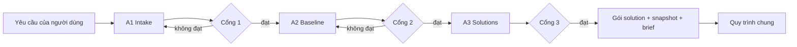
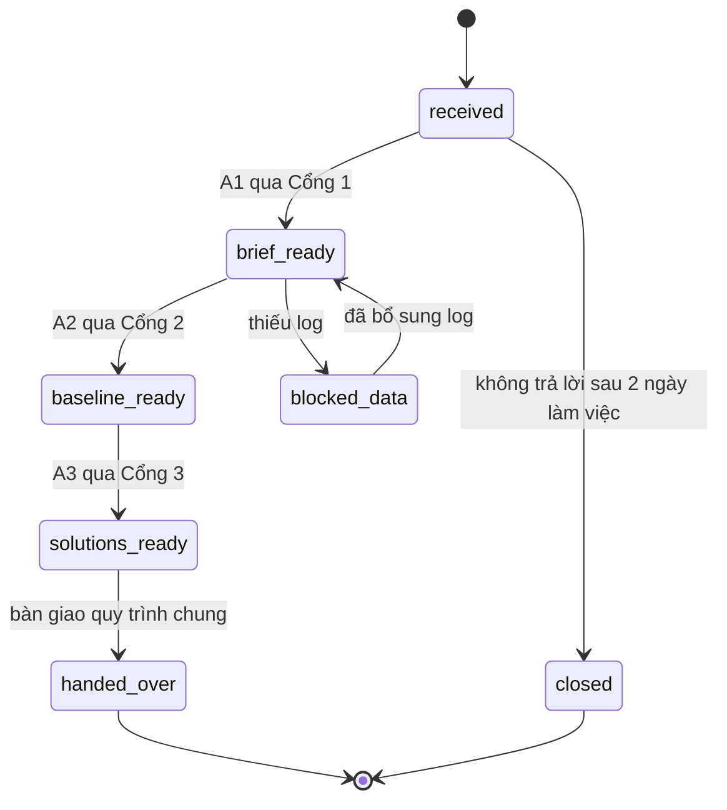

# Thiết kế Lane A: yêu cầu thủ công

> Phiên bản 1. Các tên label, field và đường dẫn trong tài liệu này là **giả định để minh họa** (đánh dấu `<...>`), cần thay bằng giá trị thật sau Phase 0. Schema dùng chung (Fingerprint, Snapshot, SolutionCard) nằm ở `03-shared-and-post-solution-design.md`.

---

## 1. Mục tiêu và phạm vi

**Mục tiêu:** từ một yêu cầu tối ưu do người nêu, tạo ra danh sách solution kèm tradeoff dựa trên dữ liệu thật, trong 3 đến 5 ngày làm việc, lặp lại được.

**Trong phạm vi:** A1 (nhận và chuẩn hóa yêu cầu), A2 (đo baseline), A3 (lên solution).

**Ngoài phạm vi:** chọn solution, implement, đo lại, rollout (thuộc quy trình chung, file 03). Lane A **không sửa hệ thống thật**.

**Nguyên tắc thiết kế**

1. Chỉ dùng log các lần chạy thật, không chạy thử riêng để đo.
2. Mọi phép đo gắn fingerprint; không có fingerprint thì không so sánh.
3. Nguyên nhân phải có bằng chứng, nếu không thì là giả thuyết.
4. Mỗi node có cổng kiểm tra; không qua cổng thì không sang node sau.

---

## 2. Luồng tổng thể



---

## 3. Thành phần

| Thành phần | Trách nhiệm | Đầu vào | Đầu ra |
|---|---|---|---|
| Intake Form | Thu yêu cầu có cấu trúc, hỏi lại khi mơ hồ | Yêu cầu tự nhiên | Optimization Brief |
| Brief Validator | Kiểm tra Cổng 1 | Brief | Đạt hoặc danh sách lỗi |
| Feature Registry | Tra feature, fingerprint, Business Rule Card | Tên feature | Hồ sơ feature |
| Log Collector | Chạy truy vấn Loki theo fingerprint | Brief, cửa sổ thời gian | Mẫu run đã lọc |
| Sample Cleaner | Loại sự cố, deploy, outlier có giải thích | Mẫu thô | Mẫu sạch, nhật ký loại |
| Bottleneck Analyzer | Phân rã step, tính phân phối | Mẫu sạch | Baseline Report |
| Config Inspector | Đọc config, prompt, flow từ code và KG, đối chiếu với log | Repo, KG | Bảng cấu hình thực tế |
| Snapshot Store | Đóng băng baseline, tái lập | Baseline Report | Snapshot ID |
| Root-cause Workbench | Ghi nguyên nhân và cách xác minh | Báo cáo, code, KG | Danh sách nguyên nhân |
| Solution Builder | Điền SolutionCard | Nguyên nhân | Danh sách solution |
| Review Gate | Domain owner duyệt nghiệp vụ | Danh sách solution | Đã duyệt hoặc loại |

---

## 4. Mô hình dữ liệu

### 4.1. Optimization Brief

```json
{
  "brief_id": "BR-2026-0001",
  "created_at": "<ISO8601>",
  "requester": "<người yêu cầu>",
  "feature": { "name": "<feature>", "fingerprint": "<xem file 03>" },
  "business_rule_card": "<đường dẫn>",
  "objectives": [
    { "metric": "latency_p50_ms", "current": 40000, "target": 25000, "direction": "down", "priority": 1 }
  ],
  "guardrails": [
    { "metric": "quality_score", "rule": ">= baseline", "hard": true },
    { "metric": "tokens_total", "rule": "<= baseline * 1.10", "hard": true }
  ],
  "thresholds": { "keep_if": "<biểu thức>", "revert_if": "<biểu thức>" },
  "max_risk_tier": "prompt",
  "scope": { "in": ["step3"], "out": ["đổi model", "đổi business rule"] }
}
```

### 4.2. Baseline Report

```json
{
  "snapshot_id": "S-0012",
  "fingerprint": "<...>",
  "window": { "from": "<ISO8601>", "to": "<ISO8601>" },
  "sample": { "runs": 0, "excluded": [{ "reason": "incident", "runs": 0 }], "weak": false },
  "overall": { "latency_ms": { "p50": 0, "p90": 0, "p99": 0 }, "tokens": { "in": 0, "out": 0 } },
  "per_step": [
    { "step": "step3", "share_time": 0.0, "share_tokens": 0.0, "p50": 0, "p90": 0, "retry_rate": 0.0, "parallelizable": false }
  ],
  "runtime_config": { "STEP3_SUBFLOW_MAX_STEPS": 6 },
  "config_mismatch": [],
  "data_gaps": ["<metric thiếu log>"],
  "queries": ["<LogQL đã chạy>"]
}
```

SolutionCard dùng schema chung ở file 03.

---

## 5. Thiết kế từng node

### A1. Intake

**Các bước xử lý**
1. Nhận yêu cầu, tra Feature Registry. Chưa có trong registry thì dừng, yêu cầu thêm feature và Business Rule Card trước.
2. Điền Brief. Với mỗi tiêu chí mơ hồ, hỏi lại tối đa 3 câu để quy ra số.
3. Xác định metric nào đo được từ Loki. Metric không có log thì ghi vào `data_gaps` ngay từ đây.
4. Chốt guardrail, ngưỡng `keep_if` và `revert_if` trước khi có số.
5. Chốt `max_risk_tier`.

**Quy tắc kiểm tra (Cổng 1)**

| Mã | Quy tắc | Khi vi phạm |
|---|---|---|
| A1-V1 | Một brief chỉ một feature và một biến thể rule | Tách thành nhiều brief |
| A1-V2 | Mọi objective có `target` bằng số và nguồn đo | Hỏi lại |
| A1-V3 | Có ít nhất một guardrail `hard` | Không qua cổng |
| A1-V4 | Có `keep_if` và `revert_if` | Không qua cổng |
| A1-V5 | Không có hai objective mâu thuẫn mà chưa có `priority` | Hỏi lại |
| A1-V6 | Có Business Rule Card đã được domain owner xác nhận | Không qua cổng |

**Trạng thái:** `draft` → `needs_clarification` → `validated`.

---

### A2. Baseline

**Các bước xử lý**
1. **Chọn cửa sổ:** mặc định 14 đến 30 ngày gần nhất (tham số `baseline_window_days`). Cửa sổ không được chứa lần đổi config nào của feature.
2. **Thu log:** chạy truy vấn theo fingerprint (mục 6).
3. **Làm sạch:** loại run trong sự cố, deploy, run lỗi hạ tầng. Mỗi lần loại ghi lý do vào `excluded`.
4. **Kiểm tra số mẫu:** dưới `min_runs` thì `weak = true`.
5. **Phân rã step:** tính tỷ trọng thời gian và token từng step, p50, p90, p99, tỷ lệ retry.
6. **Đối chiếu cấu hình:** `Config Inspector` đọc giá trị trong code và KG, so với giá trị suy ra từ log. Lệch thì ghi `config_mismatch` và phải giải thích trước khi qua cổng.
7. **Đóng băng snapshot:** lưu dưới dạng bất biến, kèm câu truy vấn và phiên bản mẫu.
8. **Đối chiếu chéo:** người thứ hai chạy lại truy vấn, so kết quả.

**Quy tắc kiểm tra (Cổng 2)**

| Mã | Quy tắc |
|---|---|
| A2-V1 | Mọi dòng log trong mẫu có fingerprint khớp |
| A2-V2 | `runs >= min_runs` hoặc `weak = true` kèm lý do |
| A2-V3 | Báo cáo có p50, p90, p99, không chỉ trung bình |
| A2-V4 | `config_mismatch` rỗng hoặc đã giải thích |
| A2-V5 | Người thứ hai tái lập được snapshot với sai lệch nhỏ hơn ngưỡng cho phép |
| A2-V6 | Cửa sổ không chứa sự kiện đổi config |

**Tham số mặc định đề xuất (cần chủ chương trình chốt):** `min_runs = 30` cho mỗi fingerprint, `baseline_window_days = 14`, sai lệch tái lập cho phép 1%.

---

### A3. Solutions

**Các bước xử lý**
1. Với mỗi bottleneck (step chiếm tỷ trọng lớn, đuôi dài, retry cao, hoặc có thể song song), lập danh sách nguyên nhân khả dĩ.
2. **Xác minh:** mỗi nguyên nhân phải khớp ít nhất một bằng chứng trực tiếp (dòng log, node KG, dòng code). Có thì `verified`, không có thì `hypothesis`.
3. Với nguyên nhân `verified`, sinh solution, mỗi solution đổi đúng một biến.
4. Gắn bậc rủi ro: `config` < `prompt` < `code`; ghi phạm vi ảnh hưởng.
5. Điền pros/cons theo từng objective và guardrail; tác động dạng khoảng; công sức.
6. Điền kế hoạch đo lại (cặp fingerprint, snapshot nào, cửa sổ đo, số mẫu tối thiểu) và đường lùi.
7. Xếp theo bậc rủi ro tăng dần. Solution vượt `max_risk_tier` gắn `over_ceiling = true`.
8. Domain owner review nghiệp vụ và guardrail.

**Quy tắc kiểm tra (Cổng 3)**

| Mã | Quy tắc |
|---|---|
| A3-V1 | 100% solution chính có `evidence` và `verification_status = verified` |
| A3-V2 | Mỗi solution có `pros_cons` cho mọi objective và guardrail |
| A3-V3 | Mỗi solution có `remeasure_plan` và `rollback` |
| A3-V4 | `expected_impact` là khoảng, có cận dưới và cận trên |
| A3-V5 | Mỗi solution chỉ đổi một biến (`change.variables.length == 1`) |
| A3-V6 | Solution `hypothesis` chỉ nằm trong mục giả thuyết |

---

## 6. Truy vấn Loki mẫu

Các label `<app>`, `<feature>` và field `duration_ms`, `step`, `tokens_in`, `tokens_out`, `retry`, `run_id`, `fingerprint` là **giả định**; điều chỉnh sau khi kiểm kê ở Phase 0.

```logql
# p90 thời gian theo step trong 14 ngày, lọc theo fingerprint
quantile_over_time(0.9,
  {app="<app>", feature="<feature>"}
  | logfmt
  | fingerprint="<fp>"
  | unwrap duration_ms [14d]
) by (step)
```

```logql
# Số run theo ngày (kiểm tra đủ mẫu và phát hiện ngày bất thường)
sum by (day) (count_over_time({app="<app>", feature="<feature>"} | logfmt | fingerprint="<fp>" | step="done" [1d]))
```

```logql
# Tỷ lệ retry theo step
sum by (step) (count_over_time({app="<app>", feature="<feature>"} | logfmt | retry="true" [14d]))
/
sum by (step) (count_over_time({app="<app>", feature="<feature>"} | logfmt [14d]))
```

---

## 7. Quy tắc thống kê

- Báo p50, p90, p99 và số mẫu; không dùng trung bình làm số duy nhất.
- Tỷ trọng step tính trên **tổng thời gian**, và tính thêm trên **đường găng** nếu có step song song (step chậm nhất trong nhóm song song mới tính vào đường găng).
- Outlier chỉ bị loại khi có lý do ghi được (sự cố, deploy); loại theo ngưỡng thống kê thuần thì phải báo thêm số liệu trước và sau khi loại.
- Baseline `weak` không bị coi là lỗi, nhưng mọi solution dựa trên nó phải gắn độ tin cậy thấp.

---

## 8. Vòng đời yêu cầu



---

## 9. Lỗi và ngoại lệ

| Tình huống | Xử lý |
|---|---|
| Loki không trả dữ liệu hoặc quá chậm | Thử lại có giới hạn; thu hẹp cửa sổ; báo `blocked_data`, không điền số ước đoán |
| Fingerprint không suy ra được từ log | Đánh dấu `not_comparable`; không gộp vào mẫu |
| Config trong code khác config suy ra từ log | Ghi `config_mismatch`; tìm lý do (override môi trường, deploy chưa hoàn tất); chặn Cổng 2 đến khi giải thích |
| Baseline nhiễm sự cố | Loại các khoảng sự cố, kéo baseline lại; không dùng baseline cũ |
| Domain owner loại solution | Ghi lý do vào kho bài học |

---

## 10. Quyền và bảo mật

- Quyền đọc Loki, KG, repo cấp theo tối thiểu cần thiết; Lane A không có quyền ghi vào hệ thống thật.
- Snapshot và brief lưu ở nơi chỉ người trong chương trình sửa được; mọi sửa đổi có lịch sử.
- Không đưa dữ liệu nghiệp vụ nhạy cảm từ log vào tài liệu; dùng số tổng hợp, mã run id thay vì nội dung.

---

## 11. Kế hoạch kiểm thử

| Loại | Nội dung |
|---|---|
| Unit | Validator của brief (A1-V1 đến V6), hàm tính phân phối, hàm lọc fingerprint |
| Đối chiếu | Với 3 run thật, so số tính bằng truy vấn với số đếm tay |
| Tái lập | Hai người độc lập chạy cùng snapshot, so kết quả |
| Hồi quy | Chạy lại brief cũ, kết quả baseline không đổi khi cửa sổ cố định |
| Tình huống xấu | Log thiếu field, mẫu ít, config lệch: hệ thống phải chặn đúng cổng |

---

## 12. Chỉ số theo dõi

- Thời gian từ yêu cầu đến solution (mục tiêu 3 đến 5 ngày làm việc).
- Tỷ lệ brief phải hỏi lại quá một vòng.
- Tỷ lệ baseline `weak`.
- Tỷ lệ solution bị domain owner loại.
- Tỷ lệ solution được giữ sau đo lại (phản hồi từ quy trình chung).

---

## 13. Câu hỏi mở

1. Tên label, field thật trong Loki và cách suy ra fingerprint từ log.
2. Giá trị `min_runs`, `baseline_window_days` phù hợp với tần suất chạy của feature.
3. Nơi lưu snapshot và brief (repo, wiki, hay dịch vụ riêng).
4. Domain owner của feature thí điểm.
