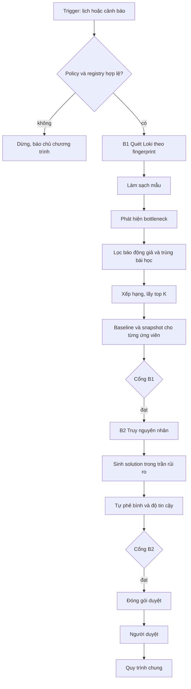
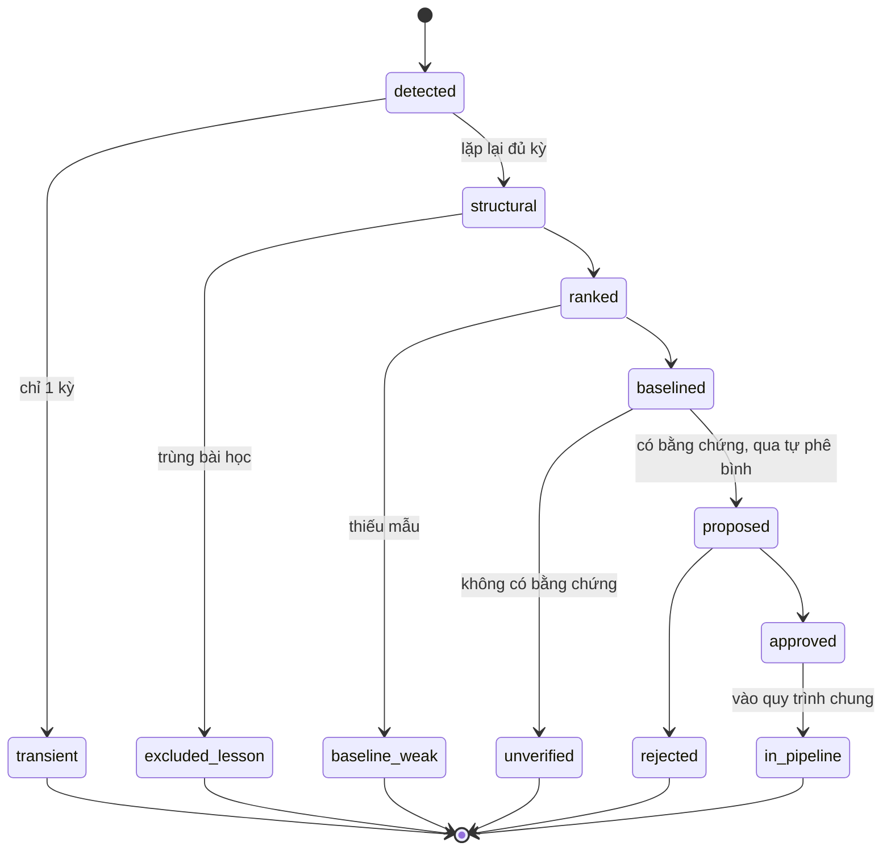

# Thiết kế Lane B: hệ thống tự phát hiện

> Phiên bản 1. Tên label, field và tham số là **giả định để minh họa** (đánh dấu `<...>`), cần thay bằng giá trị thật sau Phase 0. Schema dùng chung nằm ở `03-shared-and-post-solution-design.md`. Đọc `01-lane-a-design.md` trước, vì Lane B tái sử dụng nhiều thành phần của Lane A.

---

## 1. Mục tiêu và phạm vi

**Mục tiêu:** tự tìm bottleneck từ log các lần chạy thật, tự lấy baseline, tự lập đề xuất cùng khuôn với Lane A; người chỉ duyệt.

**Khác biệt cốt lõi so với Lane A:** không có người đặt bài toán ở đầu. Hệ thống phải tự trả lời «tối ưu cái gì, thế nào là thành công, được đụng tới đâu». Vì vậy Lane B cần **policy** làm sẵn và có quyền hạn bị giới hạn.

**Trong phạm vi:** B0 (policy và registry), B1 (quét và baseline), B2 (đề xuất), giám sát chất lượng của chính Lane B.

**Ngoài phạm vi:** tự áp dụng thay đổi. Lane B **chỉ đề xuất**; mọi thay đổi đi qua quy trình chung (file 03) với người duyệt.

**Nguyên tắc thiết kế**

1. Chỉ đọc log có sẵn, không chạy thử riêng.
2. Chỉ đề xuất trong bậc rủi ro mà policy cho phép.
3. Mọi đề xuất có bằng chứng và đường lùi; thiếu thì bị loại, không gửi người duyệt.
4. Quyền tự chủ mở dần theo số liệu, không theo niềm tin.
5. Có công tắc tắt ở mọi tầng.

---

## 2. Luồng tổng thể



---

## 3. Thành phần

| Thành phần | Trách nhiệm | Ghi chú |
|---|---|---|
| Scheduler | Chạy theo lịch và theo cảnh báo | Có giới hạn tần suất |
| Policy Store | Tiêu chí, guardrail, trần rủi ro, ngân sách quét | Mọi thay đổi có lịch sử và người duyệt |
| Feature Registry | Feature, fingerprint, step, Business Rule Card | Feature không có trong registry thì không được quét |
| Log Scanner | Truy vấn Loki theo registry | Dùng lại Log Collector của Lane A |
| Sample Cleaner | Loại sự cố, deploy, outlier có giải thích | Dùng lại của Lane A |
| Bottleneck Detector | Tìm step đáng tối ưu | Mục 5 |
| Persistence Filter | Chống báo động giả | Mục 5.2 |
| Lesson Lookup | Tra kho bài học | Mục 5.3 |
| Ranker | Xếp hạng ứng viên | Mục 5.4 |
| Baseline Builder | Tạo Baseline Report và snapshot | Dùng lại của Lane A |
| Root-cause Analyzer | Đối chiếu log, KG, code | Mục 6 |
| Proposal Generator | Sinh SolutionCard | Chỉ trong trần rủi ro |
| Self-critic | Kiểm tra trước khi gửi | Mục 6.3 |
| Confidence Scorer | Gắn độ tin cậy | Mục 6.4 |
| Review Queue | Hàng đợi duyệt, nhắc hạn | Mục 7 |
| Lane Metrics | Đo chất lượng Lane B | Mục 9 |
| Kill Switch | Tắt từng tầng | Mục 8 |

---

## 4. B0: policy và registry

### 4.1. Policy

```json
{
  "policy_id": "POL-001",
  "version": 1,
  "effective_from": "<ISO8601>",
  "approved_by": "<chủ chương trình>",
  "scan": { "schedule": "weekly", "budget_queries_per_run": 0, "top_k": 3 },
  "default_objectives": [
    { "metric": "latency_p50_ms", "direction": "down" },
    { "metric": "tokens_total", "direction": "down" }
  ],
  "default_guardrails": [
    { "metric": "quality_score", "rule": ">= baseline", "hard": true },
    { "metric": "error_rate", "rule": "<= baseline", "hard": true }
  ],
  "max_risk_tier": "config",
  "persistence": { "min_periods": 2, "share_threshold": 0.25 },
  "min_runs": 30,
  "alert_triggers": [
    { "metric": "latency_p90_ms", "condition": "above_threshold_for_2_periods" },
    { "metric": "tokens_total", "condition": "week_over_week_increase_gt_0.3" }
  ]
}
```

Các giá trị `0`, `0.25`, `0.3`, `top_k` là **đề xuất khởi điểm**, chủ chương trình chốt.

### 4.2. Feature Registry

```json
{
  "feature": "<feature>",
  "variants": [
    { "fingerprint": "<fp>", "rule_set": "<v>", "subflow_steps": 6, "env": "prod" }
  ],
  "steps": ["step1", "step2", "step3"],
  "business_rule_card": "<đường dẫn>",
  "domain_owner": "<người>",
  "lane_b_enabled": false,
  "mode": "observe"
}
```

`mode` nhận `observe` (chỉ quét), `propose` (được đề xuất). Feature mới luôn bắt đầu ở `observe`.

**Điều kiện để một feature chuyển sang `propose`:** có Business Rule Card đã xác nhận, domain owner, đã qua giai đoạn quan sát đủ số kỳ, và baseline tự lấy khớp baseline thủ công của Lane A.

---

## 5. B1: quét và phát hiện

### 5.1. Phát hiện bottleneck

Với mỗi fingerprint trong registry, trên cửa sổ quét:

1. Tính tỷ trọng thời gian và token từng step (`share`).
2. Đánh dấu step ứng viên khi thỏa **một trong** các tín hiệu:
   - `share >= share_threshold`;
   - đuôi dài: `p99 / p50` vượt ngưỡng;
   - retry cao: tỷ lệ retry vượt ngưỡng;
   - có thể song song hóa nhưng đang chạy tuần tự (suy ra từ cấu trúc flow trong KG và code).
3. Phân loại: **bottleneck cấu trúc** (lặp lại qua nhiều kỳ) hay **bất thường nhất thời** (một kỳ).

---

### 5.2. Chống báo động giả

Giữ một ứng viên chỉ khi nó xuất hiện trong ít nhất `persistence.min_periods` kỳ quét liên tiếp. Ứng viên nhất thời được ghi vào nhật ký quan sát, không đi tiếp. Nếu cảnh báo (alert) kích hoạt quét ngoài lịch thì vẫn áp dụng quy tắc này, trừ khi chủ chương trình đánh dấu khẩn cấp.

---

### 5.3. Tra kho bài học

Với mỗi ứng viên, tra kho bài học theo (fingerprint, step, loại thay đổi):

- Đã REVERT và chưa có điều kiện mới thì loại ứng viên hoặc loại hướng giải quyết đó.
- Đã GIỮ thì kiểm tra xem bottleneck vẫn còn hay đã thay đổi; nếu còn, coi là bottleneck mới và ghi nhận.
- «Điều kiện mới» gồm: đổi rule-set, đổi model, đổi cấu trúc flow, hoặc quá `lesson_ttl` (đề xuất 90 ngày).

---

### 5.4. Xếp hạng

```
score = share_time
      × runs_per_week
      × stability
      × headroom
```

- `share_time`: tỷ trọng thời gian (hoặc token, tùy objective) của step.
- `runs_per_week`: số lần feature chạy mỗi tuần, chuẩn hóa về thang 0 đến 1 theo phân vị.
- `stability`: tỷ lệ các kỳ gần đây mà step vẫn là ứng viên.
- `headroom`: ước lượng khoảng cải thiện còn lại, thô thôi (ví dụ chênh lệch giữa p50 hiện tại và p50 của các lần chạy tốt nhất cùng fingerprint). Nếu không ước lượng được thì đặt `0.5` và ghi rõ.

Công thức trên là **điểm khởi đầu**, được hiệu chỉnh sau khi so với kết quả Lane A. Lấy top K theo `score`.

---

### 5.5. Điều kiện qua Cổng B1

| Mã | Quy tắc |
|---|---|
| B1-V1 | Chỉ dữ liệu từ log có sẵn; không có truy vấn nào gây tải thêm hoặc chạy thử |
| B1-V2 | Mọi số đã lọc theo fingerprint; log không suy ra được fingerprint thì `not_comparable` |
| B1-V3 | `runs >= min_runs`; thiếu thì baseline yếu và không đi tiếp |
| B1-V4 | Ứng viên qua `persistence` |
| B1-V5 | Đã tra kho bài học |
| B1-V6 | Config thực tế đã đối chiếu với code; có `config_mismatch` thì không đi tiếp |

---

## 6. B2: đề xuất

### 6.1. Truy nguyên nhân

1. Từ ứng viên, lập danh sách nguyên nhân khả dĩ (tham số cấu hình, độ dài prompt, số bước subflow, tuần tự không cần thiết, retry).
2. Với mỗi nguyên nhân, tìm bằng chứng trực tiếp: dòng log, node KG, dòng code. Có thì `verified`, không có thì `hypothesis`.
3. Chỉ `verified` mới được sinh solution; `hypothesis` đưa vào mục riêng và **không** đi vào gói duyệt chính.

---

### 6.2. Sinh solution

- Chỉ sinh solution có `risk_tier <= policy.max_risk_tier`. Solution cao hơn trần được ghi vào «ý tưởng vượt trần» (không gửi duyệt, chỉ thông báo chủ chương trình).
- Mỗi solution đổi đúng một biến.
- Điền đủ SolutionCard (file 03), kể cả `rollback` và `remeasure_plan`.

---

### 6.3. Tự phê bình

Trước khi gửi, chạy các kiểm tra sau; không đạt thì loại và ghi lý do.

| Mã | Kiểm tra |
|---|---|
| B2-C1 | Không vi phạm guardrail trong Business Rule Card hoặc policy |
| B2-C2 | Nguyên nhân khớp bằng chứng, không mâu thuẫn dữ liệu |
| B2-C3 | Không trùng hướng đã revert trong kho bài học |
| B2-C4 | Solution không đổi quá một biến; có đường lùi |
| B2-C5 | Tác động kỳ vọng là khoảng và có cận dưới hợp lý so với dữ liệu |
| B2-C6 | Không nhắm vào step mà Business Rule Card ghi là bắt buộc giữ nguyên |

---

### 6.4. Độ tin cậy

| Mức | Điều kiện |
|---|---|
| Cao | Nguyên nhân có bằng chứng trực tiếp, đã từng GIỮ ở fingerprint tương tự, baseline đủ mẫu |
| Trung bình | Bằng chứng trực tiếp nhưng chưa từng thử, hoặc mẫu ở mức tối thiểu |
| Thấp | Bằng chứng gián tiếp, hoặc baseline `weak` |

Độ tin cậy thấp luôn cần domain owner xem thêm.

---

### 6.5. Gói duyệt

Mỗi đề xuất gửi người duyệt có: vấn đề (một câu), đề xuất, đánh đổi, bằng chứng có đường dẫn, độ tin cậy, đường lùi và quyết định cần đưa ra. Đọc xong trong vài phút.

---

## 7. Hàng đợi duyệt

- Hạn duyệt 2 ngày làm việc (đề xuất). Quá hạn thì nhắc người duyệt, rồi nhắc chủ chương trình; **không tự duyệt**.
- Kết quả: `approved`, `approved_with_changes`, `rejected`. Từ chối bắt buộc có lý do; lý do vào kho bài học.
- Giới hạn `top_k` đề xuất mỗi kỳ để tránh duyệt theo quán tính. Nếu hàng đợi cũ chưa xử lý quá ngưỡng, kỳ sau giảm `top_k`.

---

## 8. Kiểm soát và an toàn

### Bảng công tắc tắt (Kill Switches)

| Tầng | Công tắc | Ai được dùng |
|---|---|---|
| Toàn Lane B | Tắt Scheduler | Chủ chương trình |
| Theo feature | `lane_b_enabled = false` | Chủ chương trình, domain owner |
| Chỉ đề xuất | Hạ `mode` về `observe` | Chủ chương trình, domain owner |
| Tự động | Tự hạ về `observe` | Hệ thống |

**Điều kiện tự hạ về `observe`:**
- Phát hiện đề xuất vi phạm guardrail.
- Dữ liệu Loki bất thường (thiếu label, số mẫu giảm đột ngột so với kỳ trước).
- Tỷ lệ revert của feature vượt ngưỡng chủ chương trình đặt.

### Mở quyền theo giai đoạn

| Giai đoạn | `max_risk_tier` | Điều kiện sang giai đoạn sau |
|---|---|---|
| 1 | config | 2 đến 3 kỳ, tỷ lệ giữ cao, không vi phạm guardrail |
| 2 | config, prompt | Tương tự, kèm đối chiếu với Lane A |
| 3 | thêm code (vẫn qua người duyệt) | Quyết định riêng của chủ chương trình |

---

## 9. Đo chất lượng của chính Lane B

| Chỉ số | Cách tính | Dùng để |
|---|---|---|
| Tỷ lệ duyệt | đề xuất được duyệt / đề xuất đã gửi | Phát hiện đề xuất kém giá trị |
| Tỷ lệ giữ | solution GIỮ / solution đã đo lại | Quyết định mở quyền |
| Tỷ lệ revert | solution REVERT / solution đã đo lại | Quyết định hạ quyền |
| Báo động giả | ứng viên bị loại ở bước persistence sau khi đã đi tiếp bước trước / tổng ứng viên | Hiệu chỉnh ngưỡng |
| Recall so với Lane A | bottleneck Lane A tìm ra mà Lane B cũng tìm ra | Kiểm chứng tính đúng đắn |
| Vi phạm guardrail | số đề xuất bị phát hiện vi phạm | Mục tiêu: 0 |
| Độ chính xác khoảng | tỷ lệ kết quả đo thật nằm trong khoảng kỳ vọng | Hiệu chỉnh ước lượng |

---

## 10. Vòng đời ứng viên



---

## 11. Lỗi và ngoại lệ

| Tình huống | Xử lý |
|---|---|
| Loki quá tải hoặc vượt ngân sách quét | Dừng sớm kỳ này, ghi lại, không quét lại ngay |
| Fingerprint không suy ra được | Đánh dấu `not_comparable`, không gộp |
| Cảnh báo bão (nhiều feature cùng xấu đi cùng lúc) | Có thể là sự cố hạ tầng; tạm dừng đề xuất, báo chủ chương trình |
| Người duyệt không phản hồi | Nhắc, leo thang, không tự duyệt |
| Policy hết hạn hoặc bị sửa giữa kỳ | Dừng kỳ đang chạy, chạy lại với policy mới |

---

## 12. Kế hoạch kiểm thử

| Loại | Nội dung |
|---|---|
| Unit | Detector, persistence filter, ranker, các kiểm tra B2-C1 đến C6 |
| Shadow | 2 tuần chạy chỉ ghi kết quả, đối chiếu với Lane A trên feature thí điểm |
| Có chủ đích sai | Đưa dữ liệu nhiễm sự cố, fingerprint lệch, bài học trùng: hệ thống phải loại đúng |
| Kỷ luật guardrail | Đề xuất cố ý vi phạm guardrail phải bị tự phê bình chặn |
| Tải | Số truy vấn Loki mỗi kỳ không vượt ngân sách |

---

## 13. Câu hỏi mở

1. Giá trị `min_periods`, `share_threshold`, `top_k`, `lesson_ttl` thực tế.
2. Người duyệt chính và người duyệt dự phòng.
3. Cách đo `quality_score` (guardrail chất lượng) từ dữ liệu hiện có; nếu chưa có thì Lane B chỉ đề xuất ở feature đã có tín hiệu chất lượng.
4. Nơi lưu policy, registry và kho bài học.
5. Có chia được lưu lượng để rollout từng phần không.
