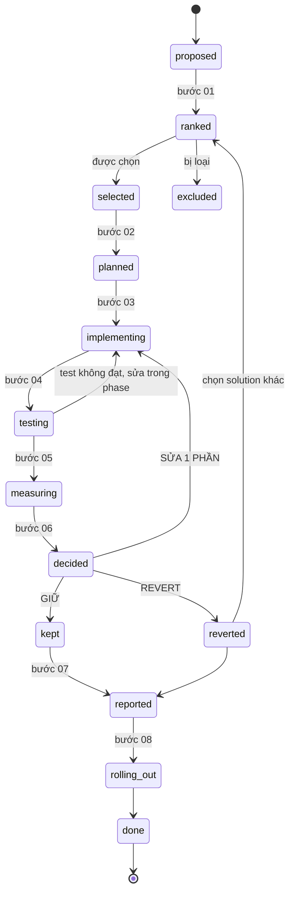

# Thiết kế phần dùng chung và quy trình sau khi có solutions (§2)

> Phiên bản 1. Cả Lane A (`01-lane-a-design.md`) và Lane B (`02-lane-b-design.md`) kết thúc ở «solutions kèm tradeoff»; file này định nghĩa **schema dùng chung** và **thiết kế 8 bước** từ Re-rank đến Rollout. Các tên đường dẫn, lệnh và ngưỡng là giả định để minh họa, cần xác nhận sau Phase 0.

---

## 1. Mục tiêu

1. Hai lane xuất cùng một định dạng để từ bước 01 trở đi quy trình không phân biệt nguồn.
2. Mỗi thay đổi đi qua từng phase nhỏ, được test, được đo với đúng baseline, và có quyết định dựa trên số.
3. Mọi kết quả (kể cả thất bại) được ghi lại để tái sử dụng.

---

## Phần I. Thiết kế dùng chung

### 2. Fingerprint

Fingerprint xác định hai lần chạy có «cùng loại» hay không.

```json
{
  "feature": "<feature>",
  "rule_set": "<phiên bản bộ rule>",
  "rule_variant": "<biến thể ảnh hưởng độ phức tạp>",
  "subflow_steps": 6,
  "env": "prod",
  "fingerprint": "<hash của các trường trên>"
}
```

**Quy tắc**

| Mã | Quy tắc |
|---|---|
| FP-1 | Hai phép đo chỉ được so sánh khi `fingerprint` bằng nhau |
| FP-2 | Trường nào quyết định độ phức tạp business rule thì phải nằm trong fingerprint |
| FP-3 | Không suy ra được fingerprint từ log thì đánh dấu `not_comparable`, không gộp |
| FP-4 | Đổi bất kỳ trường nào của fingerprint là tạo fingerprint mới, baseline phải làm lại |

---

### 3. Snapshot (baseline đóng băng)

```json
{
  "snapshot_id": "S-0012",
  "fingerprint": "<fp>",
  "window": { "from": "<ISO8601>", "to": "<ISO8601>" },
  "queries": ["<truy vấn>"],
  "sample_size": 0,
  "weak": false,
  "metrics": { "latency_ms": { "p50": 0, "p90": 0, "p99": 0 }, "tokens": { "in": 0, "out": 0 } },
  "per_step": [],
  "runtime_config": { "<key>": "<giá trị lúc đo>" },
  "created_by": "<người hoặc hệ thống>",
  "source_lane": "A",
  "immutable": true
}
```

Snapshot không bao giờ sửa; muốn thay thì tạo snapshot mới.

---

### 4. SolutionCard (schema chung)

```json
{
  "id": "SOL-0123",
  "source": { "lane": "A", "ref": "BR-2026-0001" },
  "fingerprint": "<fp>",
  "snapshot_id": "S-0012",
  "root_cause": {
    "statement": "<nguyên nhân>",
    "evidence": [{ "type": "log|kg|code", "ref": "<đường dẫn hoặc truy vấn>" }],
    "verification": "verified|hypothesis"
  },
  "change": { "description": "<cụ thể>", "variables": ["<đúng một biến>"], "risk_tier": "config|prompt|code", "blast_radius": "<phạm vi>" },
  "pros_cons": [{ "criterion": "<objective hoặc guardrail>", "pros": "<...>", "cons": "<...>" }],
  "expected_impact": { "metric": "<metric>", "low": 0, "high": 0, "unit": "%" },
  "effort": "S|M|L",
  "remeasure_plan": { "compare_to": "S-0012", "same_fingerprint": true, "window_days": 7, "min_runs": 30 },
  "rollback": { "action": "<thao tác lùi cụ thể>", "owner": "<người>" },
  "dependencies": [],
  "conflicts_with": [],
  "confidence": "high|medium|low|n/a",
  "over_ceiling": false
}
```

**Trường bắt buộc:** `id`, `source`, `fingerprint`, `snapshot_id`, `root_cause` (với `verification = verified` mới vào danh sách chính), `change`, `pros_cons`, `expected_impact`, `remeasure_plan`, `rollback`. `confidence` bắt buộc với Lane B.

---

### 5. Lesson entry (kho bài học)

```json
{
  "lesson_id": "L-0045",
  "date": "<ISO8601>",
  "solution_id": "SOL-0123",
  "fingerprint": "<fp>",
  "change": "<tóm tắt>",
  "measured": { "snapshot_before": "S-0012", "snapshot_after": "S-0019", "result": "<số>" },
  "decision": "KEEP|PARTIAL|REVERT",
  "reason": "<vì sao>",
  "revisit_if": "<điều kiện mới để thử lại>"
}
```

Ví dụ thật cần ghi vào kho: đổi `STEP3_SUBFLOW_MAX_STEPS` từ 6 xuống 3, đo đúng cặp cùng fingerprint, không có bằng chứng tốt hơn, REVERT về 6.

---

### 6. tasks.md

Mỗi dòng có mã công việc, trạng thái (`todo`, `doing`, `done`, `reverted`), đường dẫn bằng chứng, và nếu REVERT thì lý do. Cập nhật ngay khi xong, không dồn lại.

---

## Phần II. Thiết kế 8 bước sau khi có solutions

### 7. Trạng thái của một solution



---

### 8. Bước 01: Re-rank hoặc để người quyết

**Hàm chọn cách quyết định**

```
nếu solution.risk_tier == "config" và blast_radius hẹp và rollback tức thì:
    mode = "auto_rerank_notify"      # xếp tự động, thông báo, người duyệt có 1 ngày để phản đối
nếu không, nếu solution.risk_tier == "prompt":
    mode = "auto_rerank_human_pick"  # xếp tự động, người chọn trong danh sách
nếu không:                            # code, feature quan trọng, hoặc confidence thấp
    mode = "human_decides"
```

**Thuật toán re-rank**

1. Loại mọi solution vi phạm guardrail hoặc `over_ceiling` mà chưa được nới trần.
2. Loại solution có `conflicts_with` với solution đã chọn.
3. Xếp theo `expected_impact.low` (cận dưới, thận trọng) trên objective ưu tiên 1, hòa thì xét objective kế tiếp, hòa nữa thì ưu tiên bậc rủi ro thấp hơn rồi `effort` nhỏ hơn.
4. Ghi lý do chọn và lý do loại.

| Mã | Quy tắc |
|---|---|
| S01-R1 | Re-rank dùng đúng tiêu chí và thứ tự ưu tiên của brief hoặc policy |
| S01-R2 | Solution vi phạm guardrail bị loại, không chỉ bị trừ điểm |
| S01-R3 | Mỗi lần chọn và loại đều có lý do ghi lại |
| S01-R4 | Solution xung đột không chọn cùng lúc |

---

### 9. Bước 02: Lập plan và task list

**Mẫu phase**

```json
{
  "phase_id": "SOL-0123-P1",
  "change": "<đúng một biến>",
  "risk_tier": "config",
  "done_criteria": "<biểu thức bằng số, lấy từ ngưỡng brief>",
  "tests": ["<test cần chạy>", "<kiểm tra guardrail>"],
  "remeasure": { "compare_to": "S-0012", "window_days": 7, "min_runs": 30 },
  "rollback": { "action": "<thao tác>", "owner": "<người>" },
  "depends_on": [],
  "owner": "<người>"
}
```

**Quy tắc chia phase:** theo bậc rủi ro từ config đến prompt đến code; một phase một biến; phase sau chỉ bắt đầu khi phase trước đã qua bước 06 với quyết định GIỮ.

| Mã | Quy tắc |
|---|---|
| S02-R1 | Mọi phase có `done_criteria` kiểm chứng được bằng số |
| S02-R2 | Mọi phase có `remeasure` và `rollback` điền sẵn trước khi implement |
| S02-R3 | Một phase đổi đúng một biến |
| S02-R4 | Task list ghi rõ phụ thuộc |

---

### 10. Bước 03: Implement

- Một phase là một lần sửa, đánh dấu riêng (commit hoặc ghi chú) để lùi độc lập.
- Thấy việc đáng sửa ngoài phạm vi phase: ghi thành đề xuất mới, không làm.
- Trước khi sửa, xác nhận `runtime_config` hiện tại khớp snapshot; lệch thì dừng và tìm nguyên nhân.

| Mã | Quy tắc |
|---|---|
| S03-R1 | Một phase một lần sửa |
| S03-R2 | Không sửa ngoài phạm vi phase |
| S03-R3 | Có đánh dấu để lùi từng phase |

---

### 11. Bước 04: Test

- Build và test ngay sau phase.
- Test gồm hai nhóm: **chức năng** (build chạy, hồi quy) và **guardrail** (chất lượng, độ chính xác, lỗi).
- Test không đạt: sửa trong chính phase đó; không sang phase sau, không đẩy sang bước đo lại.

| Mã | Quy tắc |
|---|---|
| S04-R1 | Test ngay sau phase, không dồn lại cuối |
| S04-R2 | Không đạt thì sửa trong phase |
| S04-R3 | Có kiểm tra guardrail, không chỉ kiểm tra build |

---

### 12. Bước 05: Đo lại

#### 12.1. Cửa sổ đo

- `window_days` đủ để đạt `min_runs` cho fingerprint; feature ít chạy thì kéo dài cửa sổ, không hạ `min_runs`.
- Cửa sổ bắt đầu sau khi thay đổi đã bật ổn định (bỏ khoảng khởi động).

#### 12.2. Bộ kiểm tra tính hợp lệ của phép so sánh

Chạy **trước** khi tin bất kỳ số nào. Một kiểm tra thất bại thì phép so sánh không hợp lệ và không được dùng để quyết định.

| Mã | Kiểm tra | Cách làm |
|---|---|---|
| V-1 | Cùng fingerprint | So `fingerprint` của snapshot trước và sau |
| V-2 | Cùng độ phức tạp business rule | So `rule_set`, `rule_variant`, phân bố loại run |
| V-3 | Điều kiện tương đương | Không có sự cố, deploy khác, tải bất thường trong cửa sổ |
| V-4 | Đủ số mẫu | `runs >= min_runs` ở cả hai bên |
| V-5 | Chỉ đổi một biến | Diff `runtime_config` giữa hai snapshot chỉ ra đúng biến của phase |
| V-6 | Phân phối chứ không chỉ trung bình | Có p50, p90, p99 ở cả hai bên |

**Ví dụ thật cần nhớ:** một lần so sánh trước/sau tưởng hợp lệ nhưng hai lần đo là hai feature khác nhau, độ phức tạp business rule khác hẳn nhau. Kiểm tra V-1 và V-2 sinh ra để chặn trường hợp này. Khi gặp, không dùng số, tìm đúng cặp rồi đo lại.

#### 12.3. Đầu ra

```json
{
  "phase_id": "SOL-0123-P1",
  "compare": { "before": "S-0012", "after": "S-0019" },
  "validity": { "V-1": "pass", "V-2": "pass", "V-3": "pass", "V-4": "pass", "V-5": "pass", "V-6": "pass" },
  "result": { "latency_p50_change_pct": 0, "tokens_change_pct": 0, "guardrails": [{ "metric": "quality_score", "ok": true }] }
}
```

---

### 13. Bước 06: Quyết định

**Hàm quyết định**

```
nếu bất kỳ V-n == fail:
    decision = "INVALID"          # tìm đúng cặp, đo lại; chưa quyết định
nếu vi phạm guardrail:
    decision = "REVERT"
nếu thỏa keep_if (ngưỡng của brief/policy):
    decision = "KEEP"
nếu cải thiện đúng hướng nhưng chưa đạt, và số lần sửa của phase < 2:
    decision = "PARTIAL"           # quay lại bước 03, chỉ làm lại phase đó
nếu không:
    decision = "REVERT"            # không có bằng chứng cải thiện
```

| Quyết định | Hành động tiếp |
|---|---|
| **KEEP** | Sang bước 07; phase kế tiếp (nếu có) được phép bắt đầu |
| **PARTIAL** | Về bước 03 cho đúng phase; giới hạn 2 lần |
| **REVERT** | Lùi ngay; ghi lý do; về bước 01, chọn solution kế tiếp trong danh sách đã xếp |
| **INVALID** | Chưa quyết định; tìm đúng cặp so sánh |

| Mã | Quy tắc |
|---|---|
| S06-R1 | So với ngưỡng đã chốt từ đầu, không đặt lại ngưỡng sau khi thấy số |
| S06-R2 | Không có bằng chứng cải thiện thì REVERT, không giữ «phòng khi» |
| S06-R3 | Mọi REVERT ghi lý do vào tasks.md và kho bài học |
| S06-R4 | PARTIAL tối đa 2 lần cho một phase |

---

### 14. Bước 07: Report

Mẫu báo cáo cho mỗi solution:

```markdown
## Report: SOL-<id>
### Xong thật
- <phần đã làm, số đo trước và sau, snapshot dùng để so>
### Đơn giản hóa có lý do
- <phần bỏ hoặc làm gọn, vì sao>
### Còn thiếu
- <việc chưa làm, giả thuyết chưa xác minh, khoảng trống dữ liệu>
```

Cập nhật tài liệu xuyên suốt các bước 01 đến 06; bước này chỉ tổng hợp. Ghi một Lesson entry cho mỗi solution đã có quyết định.

---

### 15. Bước 08: Rollout

| Nấc | Phạm vi | Quan sát | Điều kiện lùi tự động |
|---|---|---|---|
| 1 | Thay đổi config, một phần nhỏ lưu lượng hoặc một nhóm (nếu hệ thống chia được) | Một cửa sổ đo | Vi phạm guardrail, lỗi hoặc retry vượt ngưỡng |
| 2 | Toàn bộ lưu lượng cho thay đổi đó | Một cửa sổ đo nữa | Như trên |
| 3 | Phần đổi hành vi rộng hơn (prompt, rồi code) | Từng phase | Như trên, cộng điều kiện của phase |

- Mỗi nấc có người chịu trách nhiệm và người biết cách lùi.
- Sau nấc cuối, tạo snapshot mới làm baseline cho vòng sau.

---

### 16. Vòng lặp

Bottleneck mới quay lại §1: qua Lane A (có yêu cầu) hoặc Lane B (tự phát hiện). Kho bài học nối các vòng; Lane B tra nó để không đề xuất lại hướng đã revert.

---

## Phần III. Tổng hợp

### 17. Vai trò

| Vai trò | Trách nhiệm trong phần này |
|---|---|
| Chủ chương trình | Chốt ngưỡng, quyết định ở bước 01 khi cần, xác nhận REVERT hoặc nới trần |
| Kỹ sư flow | Implement từng phase, đường lùi |
| Kỹ sư observability | Snapshot, đo lại |
| QA | Test, chạy bộ kiểm tra hợp lệ V-1 đến V-6 |
| Domain owner | Xác nhận guardrail nghiệp vụ, đánh giá thay đổi ảnh hưởng rule |
| Người duyệt | Duyệt trong bước 01 khi cần |

---

### 18. Chỉ số

- Số phase đi hết một vòng không phải sửa lại.
- Tỷ lệ phép so sánh bị loại vì không hợp lệ.
- Tỷ lệ GIỮ, PARTIAL, REVERT.
- Độ chính xác khoảng kỳ vọng so với kết quả thật.
- Thời gian từ solution được chọn đến rollout xong.

---

### 19. Kiểm thử

| Loại | Nội dung |
|---|---|
| Unit | Hàm chọn cách quyết định, re-rank, hàm quyết định, bộ kiểm tra V-1 đến V-6 |
| Kịch bản | Cặp so sánh cố ý khác fingerprint: phải ra `INVALID`; thay đổi vi phạm guardrail: phải `REVERT`; thay đổi không cải thiện: phải `REVERT` |
| Dry run | Chạy vòng đầy đủ trên solution mức config với feature thí điểm |
| Đường lùi | Thực hiện lùi thật ở môi trường thử trước khi dùng ở nấc rollout |

---

### 20. Câu hỏi mở

1. Ngưỡng cụ thể cho `keep_if` và `revert_if` khi brief không nêu.
2. Hệ thống có chia được lưu lượng để rollout nấc 1 không.
3. Cách tính `quality_score` để kiểm tra guardrail.
4. Nơi lưu snapshot, kho bài học và tasks.md.
